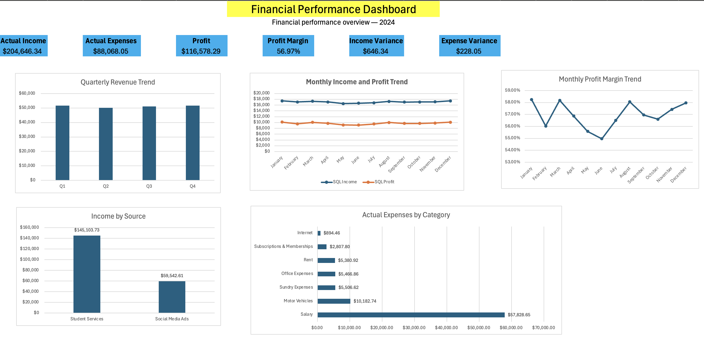

# Financial Performance Analysis — SQL & Excel

## Project Overview

This project analyses financial income and expenses using SQL and Microsoft Excel. The objective was to evaluate financial performance against budget, calculate profitability, identify major income and expense categories, and provide insights to support financial decision-making.

## Dashboard Preview

## Tools Used

- **SQL** — querying, aggregating and analysing financial data
- **Microsoft Excel** — data preparation, validation and results comparison

## Project Objectives

- Compare actual income and expenses against budgeted amounts.
- Calculate total profit and profit margin.
- Identify the largest income and expense categories.
- Analyse quarterly income performance.
- Validate SQL results against Excel calculations.

## Data Preparation and Analysis

The analysis used separate income and expense datasets. SQL queries were used to aggregate financial amounts, calculate variances and examine category-level and quarterly performance.

Excel was used to validate the SQL outputs. Monthly income, expenses, profit and profit margin calculations matched between the two methods.

## Key Findings

- **Actual income:** $204,646.34
- **Actual expenses:** $88,068.05
- **Profit:** $116,578.29
- **Profit margin:** 56.97%
- **Budgeted income:** $204,000
- **Budgeted expenses:** $87,840
- **Income variance:** $646.34 above budget (approximately 0.32%)
- **Expense variance:** $228.05 above budget (approximately 0.26%)

## Income and Expense Insights

- Student Services generated $145,103.73, representing approximately 70.9% of actual income.
- Social Media Ads generated $59,542.61, representing approximately 29.1% of actual income.
- Salaries were the largest expense category, totalling $57,828.65.
- Quarterly income was relatively consistent throughout the year, ranging from $50,180.72 in Q2 to $51,766.53 in Q1.

## Recommendations

- Monitor salary expenditure because it represents a major component of total expenses.
- Review income sources regularly to understand their contribution to overall financial performance.
- Investigate budget variances and use them to improve future budgeting accuracy.
- Continue validating SQL outputs against Excel calculations to maintain reporting reliability.

## Learning Outcomes

This project strengthened my practical skills in SQL querying, financial data analysis, budget variance analysis and Excel-based validation. It demonstrated how data analysis can translate financial records into useful business insights.
